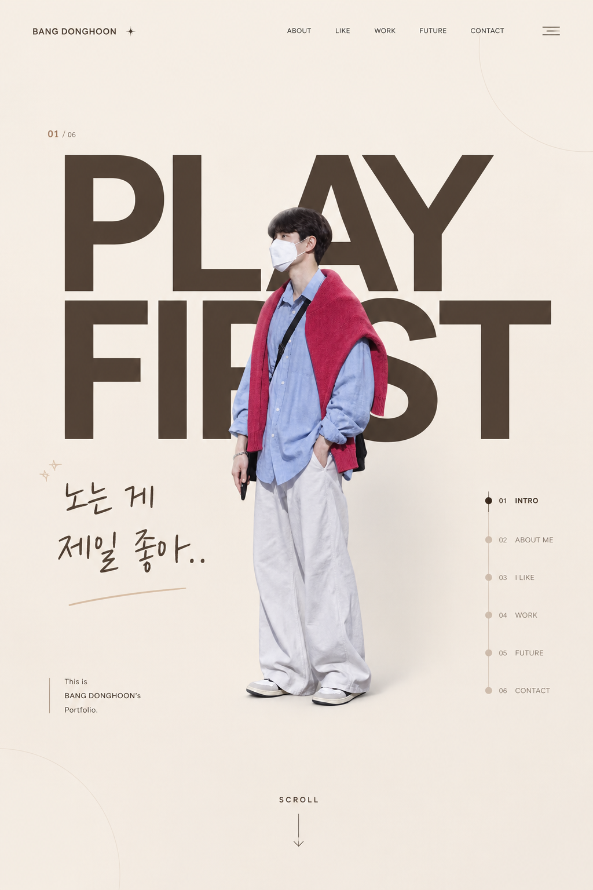
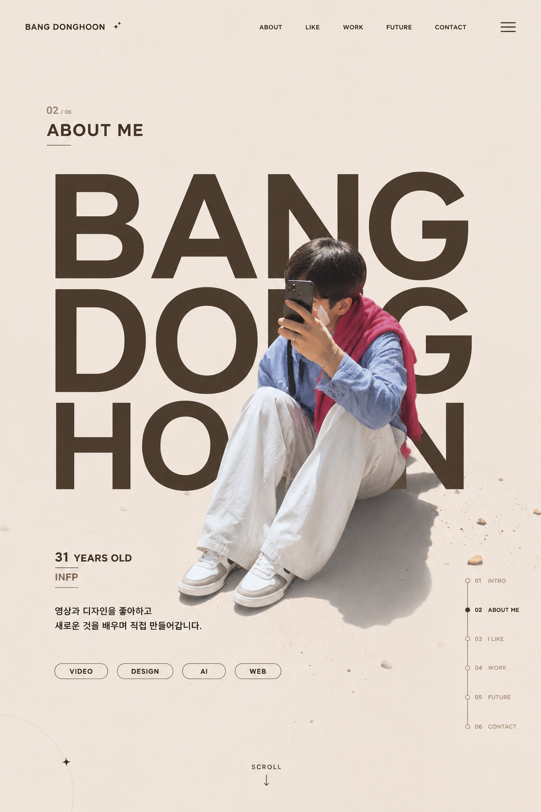

# BANG DONGHOON — 자기소개 페이지

> 노는 게 제일 좋아..

영상과 디자인을 좋아하고, 새로운 것을 배우며 직접 만들어 가는 방동훈의 자기소개 페이지입니다.
화면 시안은 ChatGPT로 만들고, 코드는 Claude와 대화하며 작성하는 **바이브코딩** 방식으로 제작했습니다.

## 링크

| 구분 | 주소 |
|---|---|
| 사이트 | [cyniardz.github.io/hoon](https://cyniardz.github.io/hoon/) |
| 제작 과정 (노션) | (노션 공개 링크 추가) |
| 인스타그램 | [@_ehdhoon](https://www.instagram.com/_ehdhoon) |

## 화면 시안

| 01 INTRO | 02 ABOUT ME |
|---|---|
|  |  |

원본 사진과 참고 이미지를 ChatGPT에서 합성해 시안을 만들고, 이 두 장을 기준으로 코드를 작성했습니다.

## 제작 방식

| 단계 | 도구 | 한 일 |
|---|---|---|
| 1. 설계 | 직접 | 섹션 구성(6개), 콘셉트, 문구 |
| 2. 시안 | ChatGPT | 원본 사진 + 참고 이미지 합성, 섹션별 화면 시안 |
| 3. 코드 | Claude | 시안과 요구 사항을 문장으로 전달해 HTML · CSS · JS 작성 |
| 4. 수정 · 배포 | VS Code, GitHub Pages | 화면 확인, 수정, 배포 |

Claude에 전달한 요구 사항 예시

- 첨부한 시안 순서대로 1번, 2번 섹션 제작
- 1섹션 왼쪽 아래 '노는 게 제일 좋아' 글씨와 겹치지 않게 배치
- 파일은 `index.html`, `style.css`, `js.js` 세 개로 나누고 서로 연결
- 모바일에서도 사용 가능하게
- 마우스 포인터를 갈색으로, 조금 더 크게

## 페이지 구성

| 번호 | 섹션 | 내용 |
|---|---|---|
| 01 | INTRO | PLAY FIRST, 대표 문구 |
| 02 | ABOUT ME | 이름, 나이, MBTI, 관심 분야 (VIDEO · DESIGN · AI · WEB) |
| 03 | LIKE | 좋아하는 것들을 스토리 형식으로 |
| 04 | 끄적끄적 (WORK) | 작업물을 스토리 형식으로 |
| 05 | FUTURE | 앞으로 하고 싶은 것, 슬라이드 |
| 06 | CONTACT | 인스타그램, 유튜브, GitHub |

## 주요 기능

- 오른쪽 섹션 내비게이션: 지금 보고 있는 섹션 표시, 누르면 해당 섹션으로 이동
- 스크롤 안내 버튼, 맨 위로 가기 버튼
- LIKE · WORK 스토리: 마우스 휠과 손가락 밀기(터치)로 넘기기
- FUTURE 슬라이더: 이전 · 다음 버튼
- 모바일 메뉴
- 배경 음악 재생 · 일시정지 버튼

## 파일 구조

```
hoon/
├─ index.html   화면 구조
├─ style.css    스타일
├─ js.js        섹션 이동, 스토리, 슬라이더, 메뉴, 음악
├─ images/      프로필, 작업물 이미지
├─ audio/       배경 음악
└─ docs/        화면 시안, 링크 미리보기 이미지
```

## 실행 방법

`index.html`을 브라우저로 열면 됩니다. 글꼴은 인터넷 연결이 필요합니다.
